# PostgreSQL + pgAdmin con Docker Compose

Entorno local con una base de datos PostgreSQL y pgAdmin para administrarla.

## Requisitos

- Docker y Docker Compose

## Configuración

Toda la configuración se lee del fichero `.env` (no se sube al repositorio). Copia la plantilla y ajusta los valores si quieres:

```bash
cp .env.example .env
```

| Variable                  | Descripción                        | Valor de ejemplo   |
| ------------------------- | ---------------------------------- | ------------------ |
| `POSTGRES_USER`           | Usuario de PostgreSQL              | `postgres`         |
| `POSTGRES_PASSWORD`       | Contraseña de PostgreSQL           | `postgres`         |
| `POSTGRES_DB`             | Base de datos que se crea al inicio| `postgres`         |
| `PGADMIN_DEFAULT_EMAIL`   | Email para entrar en pgAdmin       | `admin@admin.com`  |
| `PGADMIN_DEFAULT_PASSWORD`| Contraseña para entrar en pgAdmin  | `admin`            |

Si falta alguna variable, `docker compose` no arranca y avisa de cuál falta.

> **Nota:** `POSTGRES_USER`, `POSTGRES_PASSWORD` y `POSTGRES_DB` solo se aplican la primera vez que se crea el volumen. Si los cambias después, hay que borrar el volumen con `docker compose down -v` (se pierden los datos).

## Uso

```bash
docker compose up -d      # levantar
docker compose logs -f    # ver logs
docker compose down       # parar
docker compose down -v    # parar y borrar los datos
```

Servicios:

| Servicio   | Puerto en tu máquina | Descripción              |
| ---------- | -------------------- | ------------------------ |
| PostgreSQL | `5432`               | Base de datos            |
| pgAdmin    | `5050`               | Interfaz web de gestión  |

Los datos persisten en los volúmenes `postgres_data` y `pgadmin_data`.

## Conectarse a la base de datos

### Desde pgAdmin

1. Abre http://localhost:5050 y entra con `PGADMIN_DEFAULT_EMAIL` / `PGADMIN_DEFAULT_PASSWORD`.
2. Click derecho en **Servers → Register → Server...**
3. Pestaña **General**: pon un nombre cualquiera (ej. `local`).
4. Pestaña **Connection**:
   - **Host name/address:** `postgres` (nombre del servicio en Compose; pgAdmin corre dentro de la misma red de Docker, así que **no** uses `localhost`)
   - **Port:** `5432`
   - **Maintenance database:** el valor de `POSTGRES_DB`
   - **Username:** `POSTGRES_USER`
   - **Password:** `POSTGRES_PASSWORD`
5. **Save**.

### Desde VS Code

Instala una extensión de PostgreSQL, por ejemplo **PostgreSQL** (de Microsoft, `ms-ossdata.vscode-pgsql`), y crea una conexión con:

- **Host:** `localhost` (aquí sí, porque te conectas desde tu máquina al puerto publicado)
- **Port:** `5432`
- **Database:** `POSTGRES_DB`
- **User:** `POSTGRES_USER`
- **Password:** `POSTGRES_PASSWORD`

### Desde la terminal

```bash
docker compose exec postgres psql -U postgres -d postgres
```

O con un cliente `psql` instalado en tu máquina:

```bash
psql -h localhost -p 5432 -U postgres -d postgres
```

---

## Guía paso a paso para conectarse a la base de datos (con capturas)

Esta sección repite todo el proceso de conexión a la base de datos, con más detalle y con capturas de pantalla. Las imagenes se encuentran en `./.img/`.

### Desde pgAdmin

#### 1. Iniciar sesión en pgAdmin

Abre http://localhost:5050 en el navegador. Aparece la pantalla de login de pgAdmin: introduce el email y la contraseña definidos en `PGADMIN_DEFAULT_EMAIL` y `PGADMIN_DEFAULT_PASSWORD` del `.env` (por defecto `admin@admin.com` / `admin`) y pulsa **Login**.

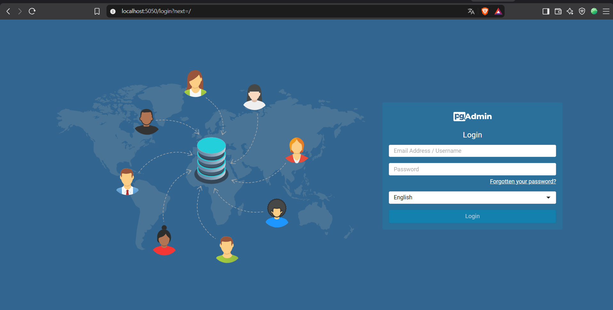

#### 2. Registrar un nuevo servidor

Una vez dentro, en el panel izquierdo (**Object Explorer**) haz click derecho sobre **Servers** y elige **Register → Server...**. También puedes usar el acceso directo **Add New Server** del Dashboard.

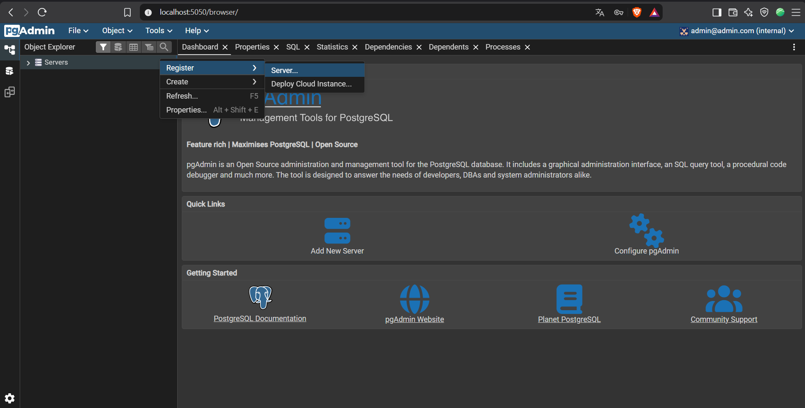

#### 3. Pestaña General

En la pestaña **General** solo hace falta rellenar **Name** con el nombre que quieras darle a la conexión (en el ejemplo, `bbdd_pruebas`). Es solo una etiqueta para identificar el servidor dentro de pgAdmin; el resto de campos se pueden dejar como están.

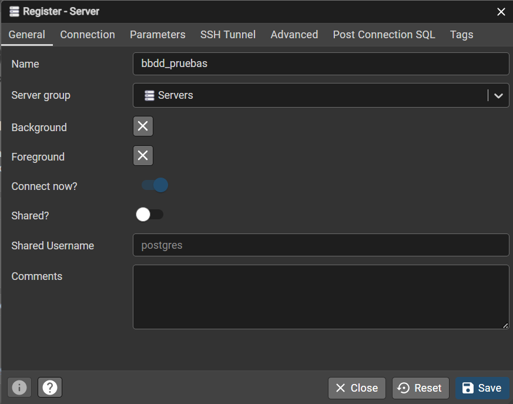

#### 4. Pestaña Connection

En la pestaña **Connection** se indican los datos reales de conexión a PostgreSQL:

| Campo                    | Valor                                                                 |
| ------------------------ | --------------------------------------------------------------------- |
| **Host name/address**    | `postgres` (nombre del servicio en `compose.yaml`, **no** `localhost`) |
| **Port**                 | `5432`                                                                |
| **Maintenance database** | valor de `POSTGRES_DB` (por defecto `postgres`)                       |
| **Username**             | valor de `POSTGRES_USER` (por defecto `postgres`)                     |
| **Password**             | valor de `POSTGRES_PASSWORD` (por defecto `postgres`)                 |

Activa **Save password?** para no tener que volver a escribir la contraseña cada vez que abras pgAdmin. Pulsa **Save**.

> **¿Por qué `postgres` y no `localhost`?** pgAdmin corre dentro de su propio contenedor, en la misma red de Docker que la base de datos. Desde ahí, `localhost` sería el propio contenedor de pgAdmin, no PostgreSQL. Docker Compose resuelve el nombre del servicio (`postgres`) a la IP del contenedor correcto.

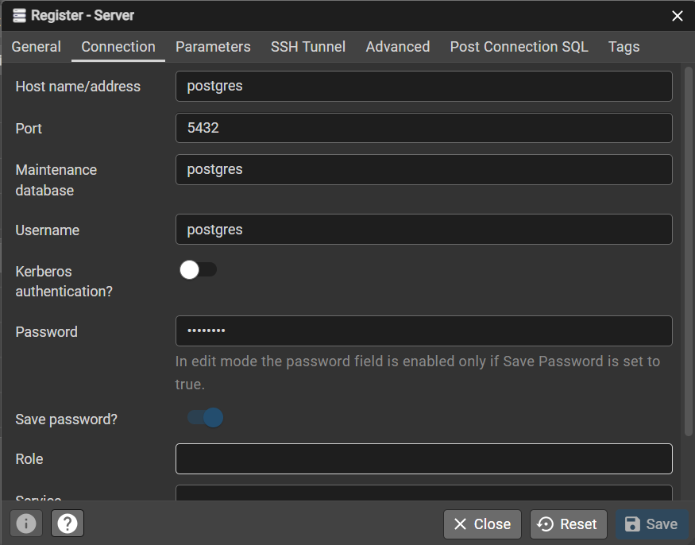

#### 5. Conexión completada

Si los datos son correctos, el servidor aparece en el **Object Explorer** con la base de datos desplegable: `Servers → bbdd_pruebas → Databases → postgres → Schemas → public`. Desde ahí puedes abrir el **Query Tool** (click derecho sobre la base de datos → **Query Tool**, o el icono de la barra superior) para lanzar consultas SQL.

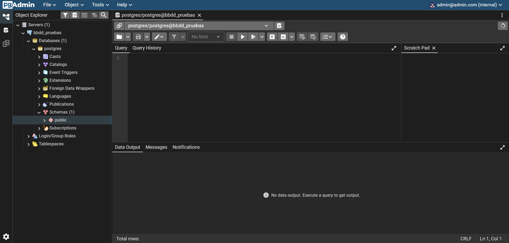

### Desde VS Code

#### 1. Instalar la extensión y abrir el panel PostgreSQL

Instala la extensión **PostgreSQL** de Microsoft (`ms-ossdata.vscode-pgsql`) desde el marketplace de VS Code. Una vez instalada aparece un icono de elefante en la barra lateral; al pulsarlo se abre el panel **PostgreSQL** con la sección **Connections**. Pulsa **+ Add Connection** para crear una conexión nueva.

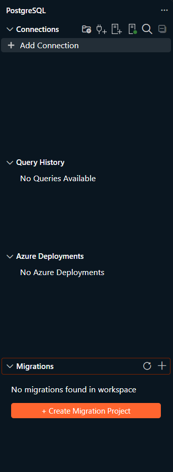

#### 2. Rellenar la conexión (pestaña Parameters)

Se abre el formulario **Connect to PostgreSQL Server**. En la pestaña **Parameters** rellena los campos con los valores del `.env`:

| Campo                   | Valor                                                                 |
| ----------------------- | --------------------------------------------------------------------- |
| **Server name**         | `localhost` (aquí sí, porque te conectas desde tu máquina al puerto publicado) |
| **Authentication type** | `Password`                                                            |
| **User name**           | valor de `POSTGRES_USER` (por defecto `postgres`)                     |
| **Password**            | valor de `POSTGRES_PASSWORD` (por defecto `postgres`)                 |
| **Save password**       | marcado, para no tener que escribirla cada vez                        |
| **Database name**       | valor de `POSTGRES_DB` (por defecto `postgres`)                       |
| **Connection name**     | opcional; un nombre para identificar la conexión en el panel          |

> **¿Por qué aquí `localhost` y en pgAdmin `postgres`?** VS Code corre en tu máquina, fuera de Docker, así que llega a PostgreSQL a través del puerto `5432` que Compose publica en `localhost`. pgAdmin, en cambio, corre dentro de un contenedor y usa el nombre del servicio de la red de Docker.

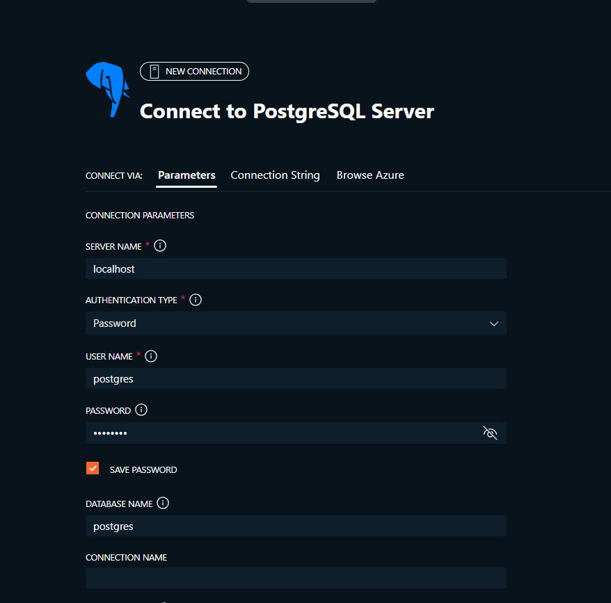

Al final del formulario, deja **Server group** en `Servers` y pulsa **Save & Connect**. Si quieres comprobar los datos antes de guardar, usa **Test Connection**.

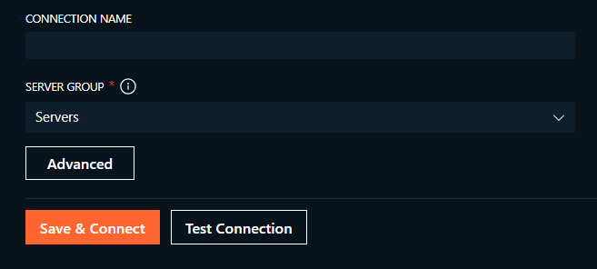

#### 3. Alternativa: pestaña Connection String

En lugar de rellenar los campos uno a uno, puedes usar la pestaña **Connection String** y pegar la cadena de conexión completa (sin la contraseña, la extensión la pide aparte):

```
postgresql://postgres@localhost:5432/postgres
```

Es decir, `postgresql://<POSTGRES_USER>@localhost:5432/<POSTGRES_DB>`. A la derecha, en **Connection details**, la extensión muestra cómo ha interpretado la cadena (server, usuario y base de datos). Después indica **Authentication type** `Password`, escribe la contraseña y marca **Save password**.

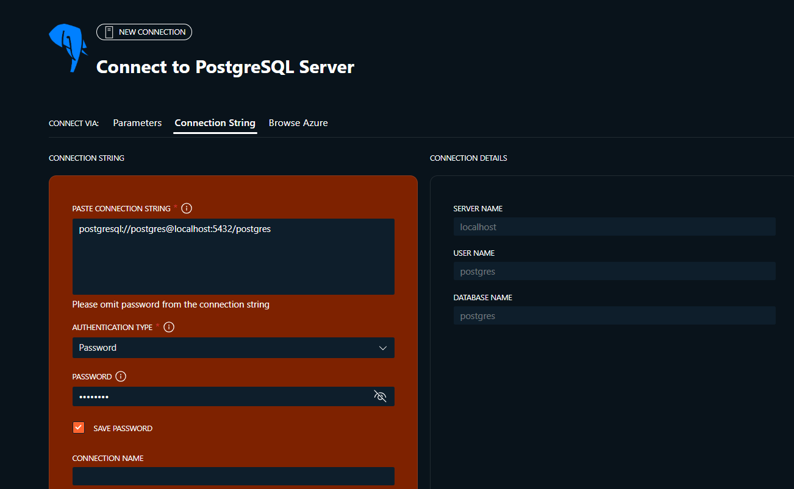

Igual que antes, deja **Server group** en `Servers` y pulsa **Save & Connect**.

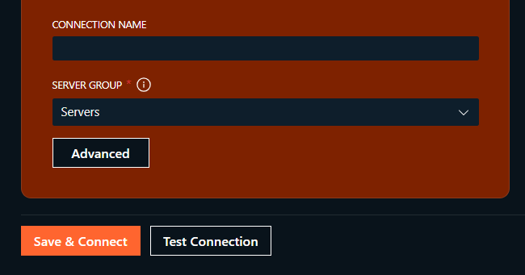

#### 4. Conexión completada

Si todo va bien, la conexión aparece en **Connections → Servers** con un punto verde y el árbol desplegable: **Databases**, **System Databases**, **Roles** y **Tablespaces**. Desde ahí puedes explorar la base de datos o abrir un editor SQL (click derecho sobre la conexión → **New Query**) para lanzar consultas.

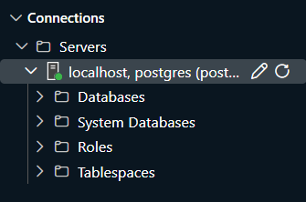

## Licencia

Este proyecto está bajo la licencia [MIT](LICENSE).
